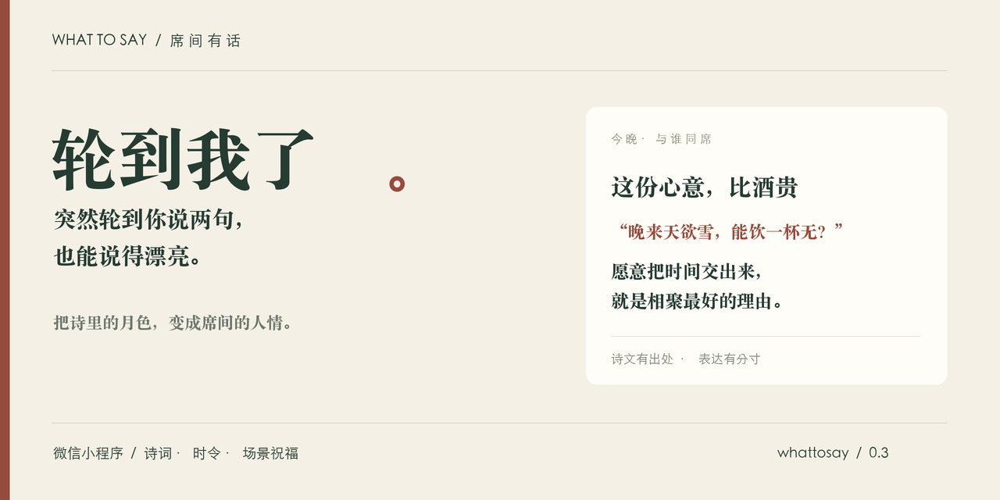
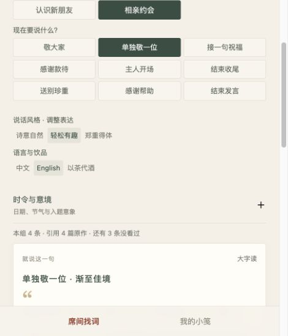
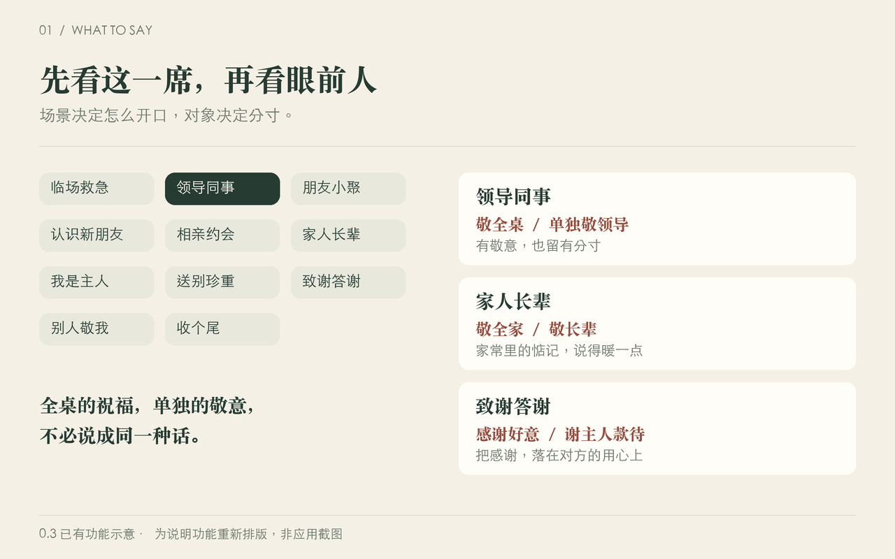
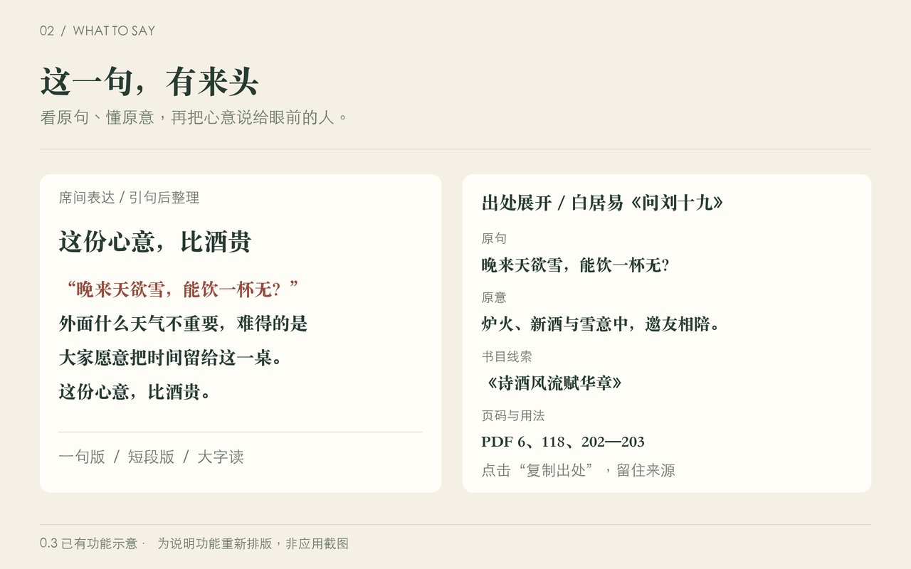
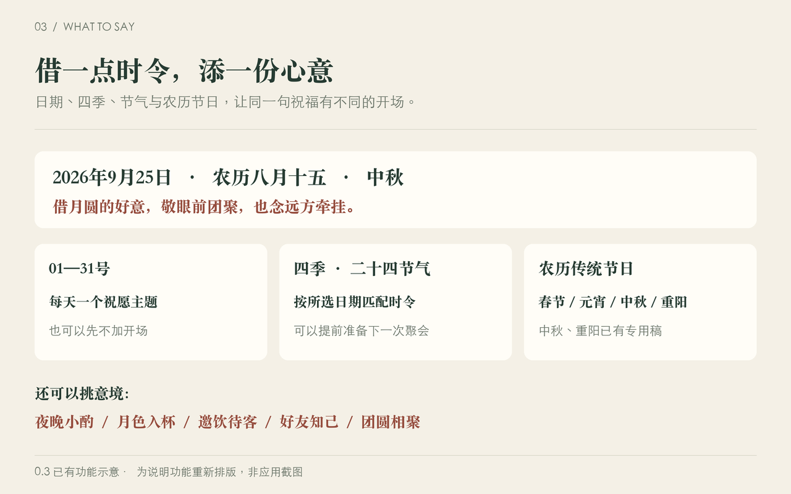
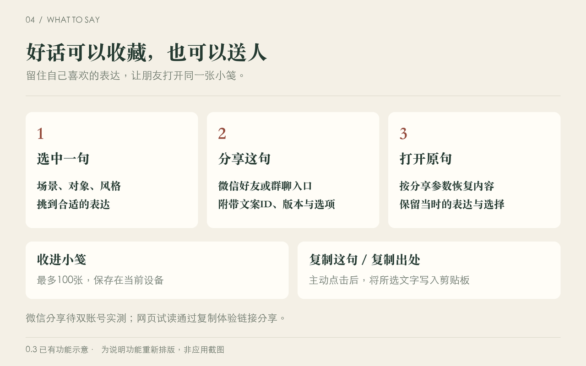

<div align="center">



# WhatToSay · 轮到我了

**把诗里的月色，变成席间的人情。**

有文采 · 有人情 · 合场景 · 能开口

[下载微信试读工程](releases/whattosay-0.6.0-preview.zip) · [浏览完整诗文库](docs/poetry-library.txt) · [功能详解](#从选场景到开口只需几步) · [本地体验](#三分钟跑起来) · [提建议](https://github.com/3013038780-design/whattosay/issues)

A poetry-inspired WeChat mini program for finding the right words at the table.

</div>

## 突然被叫起来：“来，说两句！”

朋友重逢，想说得有趣；家人团聚，想说得暖心；面对领导，想有敬意也有分寸。举起杯子的那一刻，脑子却忽然空白。

**「轮到我了」帮你接住这一刻。** 选好场景，换一句合适的话：有诗词的余味，也有对眼前人的心意。喝酒、喝茶，都能好好表达。

> 白居易有句“晚来天欲雪，能饮一杯无？”外面什么天气不重要，重要的是这桌上的人，愿意把这一段时间交出来。这份心意，比酒贵。今天这杯敬大家：愿往后忙归忙，总还有人可约，有话可聊。
>
> —— 小程序现有文案；引句出自《问刘十九》，其余为整理表达。

## 0.6：风格和英文回到眼前

选完聚会场合和说话任务，**诗意自然／轻松有趣／郑重得体**与**中文／English**直接显示在文案上方。以茶代酒也能直接选，只有时令与意境需要展开。切换语言保留当前卡片，方便中英文对照。

- **知道还能看多少**：显示当前组的文案数、所引不同完整原作数，以及本机未看过的条数。“一句版／短段版／英文”不重复计为三条。
- **补回旧稿入口**：原先新分类无法到达的92条重新安排任务和场合；“感谢帮助”与“感谢款待”、“结束发言”与“结束收尾”分别处理。熟人语气的旧稿放回朋友聚会，不硬套相亲场景。
- **增加新的原作**：新核对8篇／则，含《世说新语》两则、《唐宋词选释》三篇与独立核对的古诗词三篇，补64条任务文案。每条保留完整原文、所引句、原意与借用边界。[本轮阅读记录](docs/reading/2026-10-29-expansion-06.md)
- **轮换有依据**：优先未看过的稿件和不同作品，保存本机最近2000条浏览记录。清除本地数据会重置；普通的今天和明天通常使用同一素材池，不会自动每天生成新内容，看完有限库存仍会轮换。

当前**546条**参与推荐，含**398条**古诗文引用稿；不同引句**139处**（诗词110、古文29），不是546首诗。连历史版本共580条。全分类、对象、风格及季节节日核验后，无入口的有效稿为0条；2026年10月29日可到达539条，其余7条受季节或节日限制。[逐组数量与入口报告](docs/verification/0.6-visibility.json)



## 0.4 新增：把好词改成自己的话

- **改成我的话**：喜欢当前这句，点“改成我的话 · 另存编辑”，直接修改标题、正文、场景和对象，也可以从空白写。
- **自定义场景与称呼**：例如“同学十年聚会”“妈妈生日”“说给陈老师”。在“我的小笺 → 我写的”按自己的场景查找、继续编辑或复制。
- **本机个人小笺**：最多200张；原素材不被覆盖。个人稿保留原稿出处作参考，不提供个人内容分享。保存失败保留编辑框内容，未保存离开时提醒。
- **三书补充80篇／则**：《诗经》28首、唐宋词28阕、《世说新语》24则，各配两条场景稿，新增160条。0.4中共420条推荐文案，含272条古诗文引用稿。
- **完整原作**：引用条目均附完整诗词或故事所在完整条目，以及原意、版本页码和需要留意的语境。详见[本轮选读记录](docs/reading/2026-10-29-expansion.md)。选读与核对范围有记录，不将文字提取计为整书通读。

## 从选场景到开口，只需几步

**选什么局 → 选现在说什么 → 换一句。** 有需要时再展开出处、加一点时令，或收进自己的小笺。

下面四组展示图依据**0.3已有功能（0.4保留）**重新排版，突出按钮、内容与使用关系；它们是功能示意图。真实运行截图保留在[界面验证记录](docs/verification/screenshots/)。

## 01 · 不同的局，有不同的说法



### 原有11类内容，现在按场合与任务交叉查找

| 场景 | 什么时候用 | 表达侧重 |
| --- | --- | --- |
| **临场救急** | 突然被叫起来说两句 | 尽快找到可直接开口的祝福 |
| **领导同事** | 工作聚餐、与领导同席 | 有敬意、有分寸，照顾全桌与个人的区别 |
| **朋友小聚** | 熟人相聚、老友重逢 | 轻松谈笑，珍惜相陪与惦记 |
| **认识新朋友** | 第一次同桌、初次结识 | 自然破冰，避免假装彼此很熟 |
| **相亲约会** | 初见或互相了解 | 轻松、有余地，不替对方承诺关系 |
| **家人长辈** | 家宴、陪伴长辈 | 家常、牵挂、安康与多些相聚 |
| **我是主人** | 自己组织或招待聚会 | 欢迎来客，让大家坐得自在 |
| **送别珍重** | 朋友或同事即将启程 | 表达惦记，祝前路顺遂 |
| **致谢答谢** | 感谢帮助或感谢款待 | 把谢意落在对方付出的心意上 |
| **别人敬我** | 收到别人的祝福，需要接话 | 接住好意，再回应一份祝愿 |
| **收个尾** | 聚会临近结束 | 把相聚收好，也给下次见面留个约定 |

### 同一个场景，还要看你在对谁说

- **领导同事：敬全桌／单独敬领导。** 前者照顾在座每个人，后者使用面向个人的表达与称谓。
- **家人长辈：敬全家／敬长辈。** 全家的团聚和对长辈的关心，分别整理成稿。
- **致谢答谢：感谢好意／谢主人款待。** 回应帮助与感谢招待，各有不同的落点。

这些素材分类继续保留。0.5首页将其中的聚会背景与说话任务分开选择。不是输入姓名、职位后自动编造经历，也不会把“认识多年”“承蒙提携”等关系套在每个人身上。

### 原有风格名称与含义（0.5已简化入口）

| 风格 | 可以期待什么 |
| --- | --- |
| **随场挑** | 由程序在当前场景的适用文案中挑选 |
| **顺口祝愿** | 好念、温暖，便于把一份祝福说完整 |
| **诗词雅意** | 引一句诗文，再转到相聚、情谊与眼前的人；旧版称“诗词雅意”；0.5默认“诗意自然” |
| **诙谐妙语** | 轻松表达，部分文案带韵语或歇后语，不用冒犯别人来换笑声 |
| **English** | 独立整理的英文祝愿，配中文释义，方便理解后再开口 |

中文可切换**一句版／短段版**；**大字读**方便席间扫一眼；**以茶代酒**可以把相同心意换成适合自己的表达。部分场景或意境素材不足时会明确提示，并回到合适的现有文案。

## 02 · 不只会引用，还能讲清来处



每条文案下方都有 **“这一句，有来头”**。展开后，可以查看该条记录提供的：

| 出处细节 | 有什么用 |
| --- | --- |
| **作者、篇名、引句与完整原作** | 知道引用的是谁、哪篇作品；有原句的条目可展开完整诗词或故事条目 |
| **原意说明** | 理解诗里的情境，再判断适不适合当前这桌人 |
| **“怎么说”提示** | 了解借用了什么意境，以及称谓和现场表达的分寸 |
| **书目、页码或电子文本线索** | 便于进一步查阅；自主补充来源会说明，不冒称来自所供书籍 |
| **整理与核对说明** | 区分原作引句、编辑改写与资料核对范围 |
| **复制出处** | 把篇名、书目／页码及记录中的原作链接复制出来，留待查阅 |

例如，白居易写雪夜邀友，今天借的是**愿意相陪的心意**，不必要求外面正下雪；李白写月亮，也可以借意表达对家人的牵挂。原作与当下说法分开说明，让引用有来处，让祝福有人情。

English模式展示的是独立整理的英文表达与中文释义，不把它冒充古诗的原作译文。

## 03 · 今天几号、什么时节，都能借一句好意



### 日期与时令

- **每月1—31号**：各有一个祝愿主题，可加在文案前面，也可以选“先不加”。
- **四季**：按所选日期匹配春夏秋冬的开场表达。
- **二十四节气**：识别日期所处节气，提供相应祝愿；支持更换日期，提前准备聚会。
- **农历节日**：识别春节、元宵、中秋、重阳，显示农历日期和节日开场；**中秋、重阳已有专用稿**，在对应节日优先匹配。

例如，把日期切到 **2026年9月25日**，会识别为**农历八月十五·中秋**，可以借月圆讲团圆，也讲对远方人的牵挂。农历节日逐年换算，闰月不会误套普通月份的节日。

### 不等节日，也能挑今晚的意境

**夜晚小酌 · 月色入杯 · 邀饮待客 · 好友知己 · 团圆相聚**，再加上不限定主题的“随席取意”。

你可以先选“朋友小聚”，再挑“月色入杯”；也可以在“家人长辈”里找“团圆相聚”。程序先照顾场景和对象，再在适用内容里找诗意；没有足够素材时会提示。日期和意境提供的是表达灵感，不推断实时天气或保证现场能看见月亮。

## 04 · 喜欢的话，留给自己，也送给朋友



### 收藏：给下一次聚会留一句

点 **“收进小笺”**，到 **“我的小笺”** 再打开。收藏保留当时的文案版本与选项，可以回看，也可以移除；最多保留**100张**。当前保存在本机，换设备不自动同步。

### 分享：给朋友同一句，不是随便另抽一句

- **“分享这句”**：微信版提供好友／群分享入口，参数携带文案ID、版本，以及场景、对象、风格、长短、日期、时令方式和意境等选择。
- **朋友打开**：按这些参数恢复对应版本和选项。旧版文案保留兼容；无法恢复时会明确提示，并准备其他内容。
- **“把小程序分享给朋友”**：分享首页入口，方便对方自己挑选。
- **“复制这句／复制出处”**：分别复制表达或来源，方便粘贴；仅在主动点击时写入剪贴板，不读取已有内容。

**验证进度：** 分享参数与版本恢复已有自动检查，微信双账号好友／群分享仍待实测；公众能否打开还取决于正式审核发布。网页试读的分享按钮复制体验链接，不能发送微信小程序卡片。

### 随机：换一句，也换个角度

在所选场景与对象的适用范围中，优先选尚未看过的稿件、尚未出现的作品，再照顾表达风格的变化；近期记录在本机跨轮保留。换风格或换场景后，也尽量避免马上回到刚看过的内容。

内容库是有限的，全部看完会进入下一轮，并给出提示。**文案按完整场景整理，诗句与祝福不会被随机剪碎拼接。**

## 诗文有来处，话要落到人

我们希望收进来的句子，有一点陌生感，又让人听得懂；改写时，要能落在重逢、款待、相识、感谢这些具体情境里。

当前0.5内容规模：

- **546条**参与推荐的完整文案，其中**398条**带诗文引句。
- **131处不同引句**参与推荐；连同熟句备查和历史版本，全库**137处**。
- 本轮从三本补充书新增**80篇／则原作、160条完整场景稿**。
- 原句、原意、出处、适用对象与整理说明分别记录。现代诗目前仅收录徐志摩《偶然》的一处短句，仍待扩充。

不同场景的改写稿不算作新的诗句。熟句和历史版本保留，以兼容旧收藏、旧分享。

[0.4版Excel备份](docs/library/轮到我了_完整素材库_0.4.xlsx) · [纯文本全库](docs/poetry-library.txt) · [JSON数据导出](docs/poetry-library.json) · [阅读与整理记录](docs/corpus-study.md) · [本轮内容核对](docs/verification/poetry-03.md)

## 三分钟跑起来

### 先在浏览器试用

需要Node.js 20或更高版本。

```sh
git clone https://github.com/3013038780-design/whattosay.git
cd whattosay
npm ci
npm run preview
```

打开 `http://127.0.0.1:4173`。诗文审阅页在 `http://127.0.0.1:4173/library/poetry-library.html`；若未生成，运行 `npx tsx scripts/export-poetry.mts` 后再打开。

### 再用微信开发者工具体验

下载[独立工程包](releases/whattosay-0.6.0-preview.zip)，解压后导入其中的 `whattosay` 文件夹。无需安装npm；建议使用纯英文目录。工程配置的是项目AppID，真机预览需要该小程序的管理员或开发者权限；其他开发者请在自己的副本中换成自己的AppID。

源码开发可运行 `npm run build` 后导入仓库根目录。更多步骤见[运行说明](docs/run.md)。

**发布进度（2026-10-17）：** 0.3.0已正式上传微信开发版本，手机预览已可运行；发布者正在办理备案资料修正、隐私指引及提审手续，仓库尚无审核通过或公开发布凭证。暂未提供公众小程序码。分享功能已实现，双账号好友／群分享仍待实测；网页分享只复制体验链接。

## 怎么实现

**微信原生小程序 · TypeScript · WXML / WXSS · 本地内容库**

当前版本使用精选文案和规则筛选：先按场景、对象与时令找到合适范围，再随机轮换、避开近期内容。运行时不调用大模型，也不随机拼接半句诗和半句祝福。

- 核心选词逻辑供微信版与网页预览共用。
- 农历和节气使用 `lunar-javascript`；收藏与去重记录保存在当前设备。
- 无需注册；不请求手机号、定位或通讯录。点击复制时写入剪贴板，不读取已有内容。[数据说明](docs/privacy.md)
- 0.3的28组自动检查、类型检查与官方WXML/WXSS编译检查已通过；实际人情分寸仍需现场试读。[验证范围](docs/verification/poetry-03.md)

```sh
npm run typecheck
npm test
npm run check:wechat  # 需要本机安装官方微信开发者工具
npm run package       # 生成独立导入包
```

## 一起来添一句好话

如果你也遇过“举杯有情，开口词穷”，欢迎点个 **Star** 留住这个项目。想关注后续版本，可使用GitHub的 **Watch → Custom → Releases**。

更欢迎带着具体场景来[提Issue](https://github.com/3013038780-design/whattosay/issues)：

- **添好句**：原句、作者、篇名、可核对的来源，以及你觉得适合谁。
- **改人话**：哪一句念起来别扭、关系拿捏不准，可以怎样说。
- **报问题**：设备、微信版本、操作步骤和截图；请遮住账号及个人信息。

提交内容请使用有权分享的材料。原始书籍PDF与整本提取文本不随仓库分发。仓库尚未指定整体开源许可证，使用与再分发前请确认授权。

<details>
<summary>继续了解：需求、工程与版本记录</summary>

- [需求文档](docs/requirements.md)：文采、人情、场景与分享的产品基线。
- [产品方案](docs/product.md) · [技术架构](docs/architecture.md) · [内容规范](docs/content.md)
- [发布准备](docs/release-preparation.md) · [更新记录](CHANGELOG.md)
- [完整诗文HTML审阅页源文件](docs/poetry-library.html)：下载后打开，或通过本地服务浏览。

</details>

<p align="center"><sub>读诗知意，说话知人。愿每一次举杯，都有一句真心。</sub></p>
