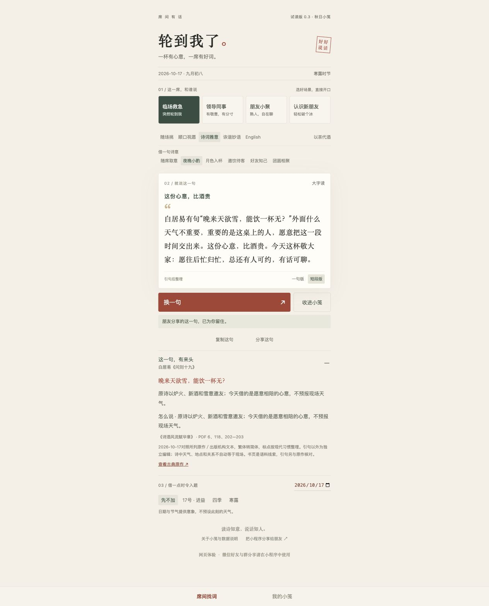

<div align="center">


# WhatToSay · 轮到我了

**把诗里的月色，变成席间的人情。**

有文采 · 有人情 · 合场景 · 能开口

[下载微信试读工程](releases/whattosay-0.3.0-preview.zip) · [浏览完整诗文库](docs/poetry-library.txt) · [本地体验](#三分钟跑起来) · [提建议](https://github.com/3013038780-design/whattosay/issues)

A poetry-inspired WeChat mini program for finding the right words at the table.

</div>

## 突然被叫起来：“来，说两句！”

朋友重逢，想说得有趣；家人团聚，想说得暖心；面对领导，想有敬意也有分寸。举起杯子的那一刻，脑子却忽然空白。

**「轮到我了」帮你接住这一刻。** 选好场景，换一句合适的话：有诗词的余味，也有对眼前人的心意。喝酒、喝茶，都能好好表达。

> 白居易有句“晚来天欲雪，能饮一杯无？”外面什么天气不重要，重要的是这桌上的人，愿意把这一段时间交出来。这份心意，比酒贵。今天这杯敬大家：愿往后忙归忙，总还有人可约，有话可聊。
>
> —— 小程序现有文案；引句出自《问刘十九》，其余为整理表达。

## 好玩在哪

| 这一刻你需要什么 | 小程序怎样帮你 |
| --- | --- |
| 刚被点名，得马上开口 | 打开就有一句，可切一句版、短段版和大字阅读 |
| 这一桌，关系不一样 | 11类场景；职场、家宴等还可细分说话对象 |
| 想有文化，又怕掉书袋 | 诗词雅意、顺口祝愿、诙谐妙语与English；展开就能看出处和原意 |
| 今晚有月色，或恰好是中秋 | 夜晚、月色、邀饮、好友、团圆主题，结合日期、四季和二十四节气入题 |
| 换了几次，总不想撞词 | 在适用内容中优先轮换未见稿件、不同作品，保留近期去重记录 |
| 这句好，想留住或送给朋友 | 本地收藏、复制文字、微信分享入口，保存所选文案及其版本 |

农历可识别春节、元宵、中秋、重阳；中秋和重阳已有对应专用稿。诗中的风雪花月可以借意，不要求现场天气相同。

## 看看实际界面

以下为0.3网页试读界面，与微信版共用核心内容与选词逻辑。

<p align="center">
  
  
</p>

## 诗文有来处，话要落到人

我们希望收进来的句子，有一点陌生感，又让人听得懂；改写时，要能落在重逢、款待、相识、感谢这些具体情境里。

当前0.3内容规模：

- **260条**参与推荐的完整文案，其中**112条**带诗文引句。
- **51处不同引句**参与推荐；连同熟句备查和历史版本，全库**57处**。
- 本轮新增**44处引句、36篇作品、62条完整场景稿**。
- 原句、原意、出处、适用对象与整理说明分别记录。现代诗目前仅收录徐志摩《偶然》的一处短句，仍待扩充。

不同场景的改写稿不算作新的诗句。熟句和历史版本保留，以兼容旧收藏、旧分享。

[纯文本全库](docs/poetry-library.txt) · [JSON数据导出](docs/poetry-library.json) · [阅读与整理记录](docs/corpus-study.md) · [本轮内容核对](docs/verification/poetry-03.md)

## 三分钟跑起来

### 先在浏览器试用

需要Node.js 20或更高版本。

```sh
git clone https://github.com/3013038780-design/whattosay.git
cd whattosay
npm ci
npm run preview
```

打开 `http://127.0.0.1:4173`。诗文审阅页在 `http://127.0.0.1:4173/library/poetry-library.html`；若未生成，运行 `npx tsx scripts/export-poetry.mts` 后再打开。

### 再用微信开发者工具体验

下载[独立工程包](releases/whattosay-0.3.0-preview.zip)，解压后导入其中的 `whattosay` 文件夹。无需安装npm；建议使用纯英文目录。工程配置的是项目AppID，真机预览需要该小程序的管理员或开发者权限；其他开发者请在自己的副本中换成自己的AppID。

源码开发可运行 `npm run build` 后导入仓库根目录。更多步骤见[运行说明](docs/run.md)。

**发布进度（2026-10-17）：** 0.3.0已正式上传微信开发版本，手机预览已可运行；微信隐私指引与提审流程正在由发布者办理，仓库尚无审核通过或公开发布凭证。暂未提供公众小程序码。分享功能已实现，双账号好友／群分享仍待实测；网页分享只复制体验链接。

## 怎么实现

**微信原生小程序 · TypeScript · WXML / WXSS · 本地内容库**

当前版本使用精选文案和规则筛选：先按场景、对象与时令找到合适范围，再随机轮换、避开近期内容。运行时不调用大模型，也不随机拼接半句诗和半句祝福。

- 核心选词逻辑供微信版与网页预览共用。
- 农历和节气使用 `lunar-javascript`；收藏与去重记录保存在当前设备。
- 无需注册；不请求手机号、定位或通讯录。点击复制时写入剪贴板，不读取已有内容。[数据说明](docs/privacy.md)
- 0.3的28组自动检查、类型检查与官方WXML/WXSS编译检查已通过；实际人情分寸仍需现场试读。[验证范围](docs/verification/poetry-03.md)

```sh
npm run typecheck
npm test
npm run check:wechat  # 需要本机安装官方微信开发者工具
npm run package       # 生成独立导入包
```

## 一起来添一句好话

如果你也遇过“举杯有情，开口词穷”，欢迎点个 **Star** 留住这个项目。想关注后续版本，可使用GitHub的 **Watch → Custom → Releases**。

更欢迎带着具体场景来[提Issue](https://github.com/3013038780-design/whattosay/issues)：

- **添好句**：原句、作者、篇名、可核对的来源，以及你觉得适合谁。
- **改人话**：哪一句念起来别扭、关系拿捏不准，可以怎样说。
- **报问题**：设备、微信版本、操作步骤和截图；请遮住账号及个人信息。

提交内容请使用有权分享的材料。原始书籍PDF与整本提取文本不随仓库分发。仓库尚未指定整体开源许可证，使用与再分发前请确认授权。

<details>
<summary>继续了解：需求、工程与版本记录</summary>

- [需求文档](docs/requirements.md)：文采、人情、场景与分享的产品基线。
- [产品方案](docs/product.md) · [技术架构](docs/architecture.md) · [内容规范](docs/content.md)
- [发布准备](docs/release-preparation.md) · [更新记录](CHANGELOG.md)
- [完整诗文HTML审阅页源文件](docs/poetry-library.html)：下载后打开，或通过本地服务浏览。

</details>

<p align="center"><sub>读诗知意，说话知人。愿每一次举杯，都有一句真心。</sub></p>
