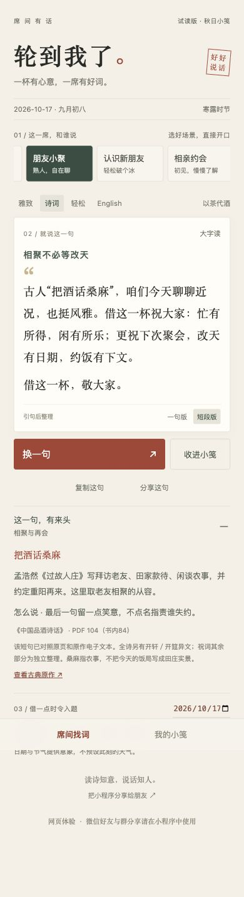
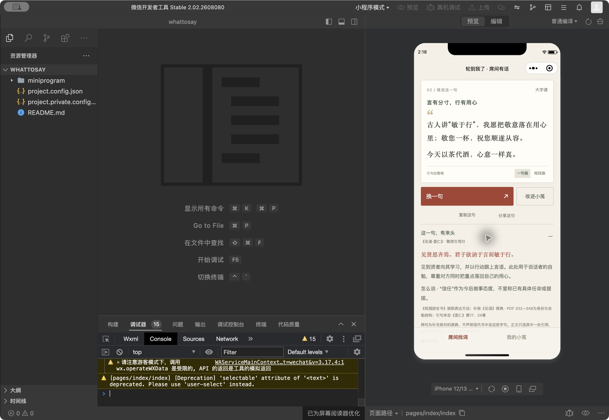

# 首版工程验证记录

2026-10-17。验证对象为仓库当前原生工程、构建产物逻辑与共享核心的网页体验版。

## 已执行

- `npm run typecheck`：TypeScript检查通过。
- `npm test`：18组测试通过；包括构建后的原生Page事件、两个独立模拟客户端的分享恢复和收藏隔离。
- 日期遍历2024—2026年每个公历日；检查有效节气、31日号主题、跨年和闰日。
- 场景、对象、语言、长短、饮品与日历组合的分享序列化/恢复检查。
- 本地浏览器实际操作：领导场景敬全桌/单独敬领导、长短切换、收藏后打开、英文、大字显示。
- 手机宽度320px检查英文大字版：文档宽度与滚动宽度均为320，无页面横向溢出。390px检查中文诗意版本。
- 原生页面脚本构建约411KiB，低于微信主包常见容量限制；这仅是该脚本大小，不作为微信包审核结论。

## 独立日历参照

香港天文台[2024年对照表](https://www.hko.gov.hk/tc/gts/time/calendar/pdf/files/2024.pdf)清明为4月4日，[2026年对照表](https://www.hko.gov.hk/tc/gts/time/calendar/pdf/files/2026.pdf)清明为4月5日，与测试一致。

计算使用锁定版本 lunar-javascript，代码/许可证随构建打包。取北京时间公历日期，交节按当天区分，不提供具体交节时刻。四季按立春、立夏、立秋、立冬起算。支持日期范围2000—2099；远期日历仍可能受天文算法精度影响，未对100年每个节气逐一比对官方表。

## 未完成的验证

目前已安装官方开发者工具，完成WXML/WXSS编译并在游客模式模拟器运行；尚无实际AppID，微信真机预览和双微信账号好友/群分享测试仍未完成。浏览器不会发送微信卡片；原生分享事件和参数恢复测试也不能替代微信实际发送。

未测得真机300ms性能目标；未上传体验版、提交审核或公开发布。首次安装的小程序仍须微信加载代码包，本地内容能力不等于首次启动无需网络。

## 技术参考

- [微信官方示例仓库](https://github.com/wechat-miniprogram/miniprogram-demo)
- [微信Page文档](https://developers.weixin.qq.com/miniprogram/dev/reference/api/Page.html)：网页工具本次未能读取正文；事件签名另由安装的微信类型定义检查。
- [lunar-javascript项目与许可](https://github.com/6tail/lunar-javascript)

手机界面截图：

提交d524af6的[GitHub持续集成](https://github.com/3013038780-design/whattosay/actions/runs/38946445643)已实际完成并通过（当时17组测试）；本轮18组本机测试及打包验证另记录，不用上一提交的绿灯代表后续改动。

## 官方原生编译器补充验证

2026-10-17：从腾讯官方dldir1.qq.com下载微信开发者工具2.02.2608080 ARM64，下载哈希与Homebrew公开包记录一致；macOS签名显示Tencent Technology (Shanghai) Company Limited。未接受新账号协议或代用户登录。

已执行工具包内的wcc编译当前WXML，并分别用wcsc检查app.wxss和页面WXSS，均产生非空编译输出，未报错。页面样式与app样式分开编译，未用只编译首个根文件的结果推断整个样式通过。

此为离线格式编译验证，仍不等于开发者工具界面运行、真机体验、双账号发送或微信发布。可用npm run check:wechat复现；该脚本需要本机官方工具，结果保存在dist/validation/wechat-compile.json。

## 游客模式模拟器运行验证

同一工程在本机包含中文的源码路径和独立包路径停在Loading project all files；将独立包放入纯英文临时目录后成功运行。该观察仅说明本机工具的路径兼容问题，不推断所有微信工具都不支持中文。交付说明建议解压到英文目录。

实际运行：官方工具2.02.2608080 ARM64、基础库3.17.4、iPhone12/13模拟器。已操作换句、收藏、收藏页打开原句、家宴敬长辈、职场敬全桌/敬领导、英文和以茶代酒组合、出处展开。

原生运行暴露了普通button的默认尺寸与网页不同，现用带aria-role的自定义控件承载普通操作，保留原生button执行微信分享；并改为类选择器，避免页面组件样式的标签选择器告警。源码数据不再显式写入未定义的seasons字段。首屏默认诗文一句版，保留短段切换。

控制台已有游客API限制、基础库预加载和早期样式选择器告警；游客API返回不能当作真实账号结果。当前观察未见项目脚本运行错误。SDK限制和真实分享仍待登录后验证。

## 编辑更新与独立包复核

“乐在相逢”增加v2，保留v1分享正文；类型定义允许正整数内容版本，注册表检查ID+版本唯一、同一ID只推荐一个版本。18组测试通过，类型检查和官方WXML/WXSS编译通过。另将实际交付zip解压到全新临时目录，以包内原生脚本建立两个Page实例，验证v1/v2分别恢复、v2分享携带v=2，均通过。该检查模拟微信API，不冒称真实微信发送。
