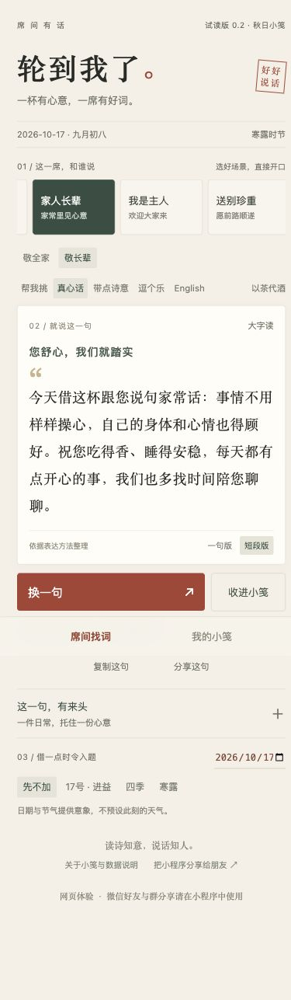

# 0.2口语与多样性验证

> 2026-10-17更新：当前为0.2.1，恢复原有诗文推荐，默认诗词雅意；口语为补充。共228条推荐。下文0.1/0.2记录属于对应版本的历史验证，最新规则以[需求文档第13节](../requirements.md)为准。

2026-10-17。

## 本轮问题与修改

旧版默认诗文模式，每个具体场景往往只剩一两条候选；轮换耗尽后可能立刻重复上一条，重开也丢失浏览历史。正文多以解释古人引句开场，并统一追加举杯结尾。

新版默认“帮我挑”，在场景/对象约束下混合选出完整文案。168条新推荐，14组各12条，每组4条真心话、4条带点诗意、4条逗个乐，英文独立编写。先从未看过的条目中选；有条件时分散最近两条的风格和引用来源；看完一组后轮换，避开上一条。最近浏览记录本机最多500个ID，与收藏分开保存。完整段落独立编辑，不随机拼接主语、典故和结尾。

56个旧内容版本仍可按ID+版本恢复。已有分享与收藏不会换成新文案。当前168是有限内容池，不声称无限生成；选择单一中文风格时，每组4条，耗尽后会轮换。

## 已执行的验证

- TypeScript检查通过。
- 21组全量测试通过，覆盖新旧内容/语言/长短/茶代酒/时令的分享恢复，以及浏览历史、候选数量和原生Page事件。
- 后续增加风格分散规则，另执行4项核心定向测试与3项原生事件测试，均通过。完整测试现共22组，后续GitHub检查会按最新提交全量运行。
- 官方wcc/wcsc编译通过：1个WXML页面、2个WXSS根文件。
- 实际0.2独立zip内的原生脚本验证：默认auto、连续12个不同ID、旧v2分享保持原文，均通过。
- 浏览器实际切家宴敬长辈，连续12次得到12个不同标题；小屏实测文档宽与滚动宽均375px，无页面横向溢出。进一步检查长段与新分享路径。
- 微信实际AppID工程重新打开并编译显示“试读版0.2”，原生换句连续见到真心话、诗意、轻松三类；运行观察无持续业务脚本异常，仍有基础库预加载提示。
- 0.2预览上传成功，工具显示573 KB，16.94秒，已生成供用户手机重试的二维码。二维码与登录头像只留本机。

## 仍待用户确认

用户已确认旧版手机能打开、控件能点击；本轮0.2随机体验、人情分寸和口头自然度需再次试用。双微信账号好友/群分享和正式发布没有因此自动完成。

